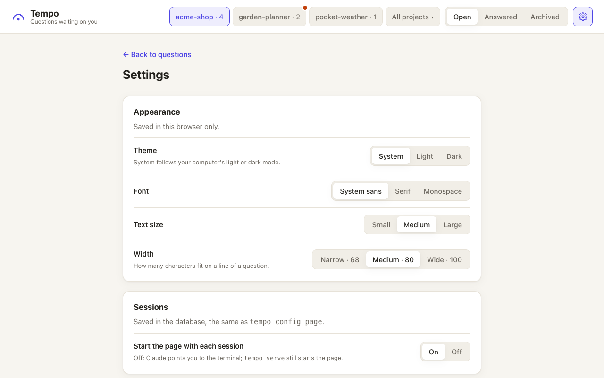

# Tempo

[](https://github.com/andrebras/tempo/actions/workflows/ci.yml)
[](LICENSE)


You set the tempo; Claude follows. Like a conductor, you decide, and Claude picks up your
decisions and keeps playing.

Tempo is a [Claude Code](https://code.claude.com) plugin. When Claude needs a decision from
you, it saves the question with all the context you need, instead of letting it scroll away
in chat. You answer on a local page whenever it suits you, and Claude picks the answer up by
itself.

- 🎬 [See it in action](#see-it-in-action)
- 📦 [Install](#install)
- 🎛️ [Usage](#usage)
- ⌨️ [From the terminal](#from-the-terminal): the `tempo` commands, the full-screen
  `tempo tui`, tmux and the status line
- 💬 [In the Claude Code session](#in-the-claude-code-session): slash commands
- ⚙️ [How it works](#how-it-works)
- 🔒 [Security](#security)
- 🤝 [Contributing](#contributing)

## See it in action

Both recordings show the same steps, once on the local page and once in the terminal. You
answer a question with a note, and Tempo moves on to the next one. There you ask for more
context; Claude rewords the question, and its thread shows what you asked and what changed.

**On the page**


**In the terminal, with `tempo tui`**


The recordings use made-up questions; `bin/media` makes them again (see
[CONTRIBUTING.md](CONTRIBUTING.md#screenshots-and-demo-gifs)).

## Install

```bash
claude plugin marketplace add andrebras/tempo
claude plugin install tempo@tempo
```

You need Python 3.9 or newer; on a Mac, Apple's Command Line Tools include one
(`xcode-select --install`). Installing from the marketplace also needs Git. Tempo has no other
dependencies.
Start a new Claude Code session afterwards: sessions that were already open don't load it.

To try it for one session without installing it, clone the repo and run
`claude --plugin-dir .` inside the clone.

## Usage

There's nothing to run. When a Claude Code session starts, Tempo starts its page at
<http://127.0.0.1:2204/>. If a Tempo page is already running there, it is kept, unless it comes
from an older version of Tempo or no longer works; then Tempo replaces it (details in
[The page server](docs/reference.md#the-page-server)). When Claude needs a
decision, it adds a question and links to it in chat. On the page you can:

- **Answer**: pick an option, add a note if you like, and send it. The page moves on to the
  next open question. If Claude rewords the question while you answer, the page refuses the
  answer, shows the new wording and keeps your note, so a letter never lands on an option
  you didn't see.
- **Ask for more context**: say what's unclear. Claude adds an explanation or rewords the
  question, and the question's thread shows what changed.
- **Reopen** an answered question to change your answer.
- **Find a question**: the search box filters the list, and the **Open**, **Answered** and
  **Archived** tabs switch between open questions, answered ones and older ones.
- **Switch projects** with the chips in the header: one per project with something for you,
  showing its open count. A dot on a chip means something new arrived there since you last
  looked. **All projects ▾** lists every project.
- **Spot what changed**: a dot after a question's number in the list means the question is new,
  or Claude reworded it or added context, since you last opened it.
- **Adjust Settings** with the gear button: theme, font, text size and line width, whether
  each session starts the page, and project names. Settings also lists the folders each
  project covers. When a folder looks renamed or moved, a banner asks whether to link it to
  its old project.

<picture>
  <source media="(prefers-color-scheme: dark)" srcset="docs/settings-dark.png">
  <source media="(prefers-color-scheme: light)" srcset="docs/settings-light.png">
  
</picture>

Every question has a number per project that is never reused, so answering "12b" in chat
works too. Joining two projects renumbers the questions that move.

If you would rather answer from the terminal, run `tempo config page off` (or use the switch
under Sessions in Settings): sessions then stop
starting the page, and Claude points you to `tempo show` and `tempo answer` instead of page
links. `tempo serve --background` still starts the page when you want it, and
`tempo config page on` brings back the default (`tempo config` shows the current value).

## From the terminal

You can also answer without opening the page. These commands are for you, not for Claude, and
work like the page: Claude gets what you send through the same hooks and `tempo wait`.

`tempo` is on Claude Code's `PATH` only inside a session. To use it in your own shell, add an
alias, for example in `~/.zshrc`:

```bash
alias tempo=~/.claude/plugins/marketplaces/tempo/bin/tempo
```

That path is Tempo's marketplace copy, which `claude plugin marketplace update tempo` keeps
up to date. Sessions run the installed copy in `~/.claude/plugins/cache/tempo/tempo/<version>/`, so the marketplace path is the one that doesn't change. If
you cloned Tempo yourself, use your clone's `bin/tempo` instead. The same goes for every
path in the examples below.

```bash
tempo list                                # the project's open questions
tempo show 12                             # one question, with its options and thread
tempo answer 12 b                         # answer Q12 with option (b)
tempo answer 61 yes                       # or name the option by its text
tempo answer 12 b --note "Keep it small"  # with a note
tempo reply 12 "What would (c) cost?"     # ask for more context, like the page's follow-up
```

They act on the project of the folder you run them in; add `--project NAME` for another one
(`tempo list --all-projects` shows every project's questions).

### The full-screen view: `tempo tui`

`tempo tui` shows the open questions, as the page does, in the terminal, with panels side
by side as in lazygit, and you use it only with the keyboard. It needs nothing installed: it is drawn with
curses, which comes with Python. Projects (top left) lists every project with open questions,
plus the current folder's, with how many are open; a dot marks the ones with questions waiting
for you. Questions (bottom left) lists the selected project's open questions, grouped by goal
as on the page: `»` marks the goal's start-here question, `…` one waiting on Claude, and
`quick` one that is quick to answer. Detail (right) shows the selected question: its context,
the lettered options with the recommended one marked, and its thread. The bottom line shows the
keys for the panel you are in.

[The recording above](#see-it-in-action) shows it at work.

| Key | What it does |
| --- | --- |
| `j` `k`, `↓` `↑` | Move to the next or previous project or question; in Detail, scroll |
| `h` `l`, `←` `→`, `Tab` `Shift-Tab` | Go to the previous or next panel |
| `Enter` | Go from Projects to Questions, and from Questions to Detail |
| `a`, `b`, `c`… | Answer the selected question with that option. The bottom line asks first: `y` sends, `e` adds a note before sending, `n` or `Esc` cancels |
| `A`, `B`, `C`… | The same. Use Shift for options `h`, `j`, `k`, `l`, `q` and `r`, since those letters also move or quit |
| `r` | Ask Claude for more (a follow-up): type it on the bottom line, `Enter` sends, `Esc` cancels |
| `PgDn` `PgUp`, `Ctrl-d` `Ctrl-u` | Scroll the detail by a page |
| `?` | Show the keys |
| `q`, `Esc` | Quit |

Answers and follow-ups are saved exactly as the page and `tempo answer` save them, so Claude
gets them the same way. The bottom line then says what was saved, or why it was refused (for
example, when the question was answered on the page meanwhile). The screen follows changes by
itself within a second or two: a question Claude adds or rewords, or an answer from the page.
On a screen narrower than 60 characters or shorter than 10 lines it shows one panel at a time, and `h` and `l` go to
the others. Set `NO_COLOR` to turn colors off. It never starts the page. For answered and
archived questions, search and Settings, use the page.

Text you paste goes into the note or follow-up you are writing, line breaks included (shown
as `↵`). In a terminal with bracketed paste, which marks pasted text and which most have, a
paste never acts as keys, so a newline in it doesn't send and a letter doesn't pick an option.
Pasting anywhere else only shows a hint on the bottom line. Alt (Option on a Mac) with a key, such as
Option+Left, is ignored too, rather than read as `Esc` and then a letter.

### `tempo tui` in a tmux popup

tmux can open `tempo tui` in a popup window over your panes, and close it when you quit.
Add this to `~/.tmux.conf` to open it with `prefix` then `T` (`display-popup` needs tmux 3.2
or later):

```tmux
bind T display-popup -E -w 90% -h 85% -d "#{pane_current_path}" "~/.claude/plugins/marketplaces/tempo/bin/tempo tui"
```

`-E` closes the popup when `tempo tui` ends, `-w` and `-h` set its size, and `-d` starts it in
the current pane's folder, so it opens on that folder's project. To open it with `Alt-t`
alone, without the prefix, add this line too (`-n` means no prefix):

```tmux
bind -n M-t display-popup -E -w 90% -h 85% -d "#{pane_current_path}" "~/.claude/plugins/marketplaces/tempo/bin/tempo tui"
```

Then reload the file with `tmux source-file ~/.tmux.conf`.

### A badge in the tmux status bar

`tempo status` prints `? 3` when the current folder's project has three open questions, and
nothing when it has none, just like the page shows one project at a time. In a
pane in `~/Lab/shop` it counts shop's questions, not another project's. `--project NAME`
counts one project by name and `--all` counts every project. It only reads the database, so it
is quick and safe to run every few seconds, and it never starts the page. To show it in tmux,
add this to `~/.tmux.conf` (use the full path of `bin/tempo`, because tmux runs it outside
your shell and its aliases):

```tmux
set -g status-interval 5
set -g status-right '#(cd "#{pane_current_path}" && ~/.claude/plugins/marketplaces/tempo/bin/tempo status) %H:%M'
```

tmux fills in `#{pane_current_path}`, the folder of the pane you are in, so the badge follows
you from project to project.

To see a badge on every pane instead, each for its own folder, show it in the pane borders:

```tmux
set -g pane-border-status top
set -g pane-border-format ' #(cd "#{pane_current_path}" && ~/.claude/plugins/marketplaces/tempo/bin/tempo status) #{pane_current_command} '
```

Then reload it with `tmux source-file ~/.tmux.conf`.

### A badge in the Claude Code status line

Claude Code can show a status line under the prompt: it runs a command you choose and shows
what it prints. Claude Code passes the command details about the session as JSON on its
standard input, including the session's folder in `workspace.current_dir`. Run
`tempo status` in that folder to add the badge for the session's project.

If you already have a status line script, add these two lines to it and print `$tempo` at
the end of its output (they use [jq](https://jqlang.org) to read the JSON):

```sh
dir=$(printf '%s' "$input" | jq -r '.workspace.current_dir')
tempo=$(cd "$dir" && ~/.claude/plugins/marketplaces/tempo/bin/tempo status 2>/dev/null)
```

Here `$input` holds the JSON the script read with `input=$(cat)`. A whole script that shows
only the folder's name and the badge looks like this, saved as `~/.claude/statusline.sh`
and made runnable with `chmod +x ~/.claude/statusline.sh`:

```sh
#!/bin/sh
input=$(cat)
dir=$(printf '%s' "$input" | jq -r '.workspace.current_dir')
tempo=$(cd "$dir" && ~/.claude/plugins/marketplaces/tempo/bin/tempo status 2>/dev/null)
printf '%s %s\n' "$(basename "$dir")" "$tempo"
```

Then point Claude Code at it in `~/.claude/settings.json`:

```json
{
  "statusLine": { "type": "command", "command": "~/.claude/statusline.sh" }
}
```

## In the Claude Code session

The same, without leaving the session: type one of these slash commands in Claude Code. They
are for you, not for Claude (Claude Code does not let Claude invoke them). They record your
answer or follow-up before Claude reads anything, so it comes from you and reaches Claude
once, right away.

```text
/tempo:list                          # the project's open questions
/tempo:show 57                       # one question, with its options and thread
/tempo:answer 57a                    # answer Q57 with option (a); also 57 a, Q57a, Q57 a)
/tempo:answer 57a keep the old flag  # with a note
/tempo:answer 61 yes                 # name the option by its text, in any case
/tempo:dive 57                       # ask for more ("Tell me more.")
/tempo:dive 57 why not b?            # ask something specific
```

After `/tempo:answer` Claude acts on the answer. After `/tempo:dive` Claude digs in and
answers in the question itself, so the page shows the new explanation. An unknown question
or option records nothing and shows Tempo's error instead.

## How it works

```
 Claude ──tempo add / context / reword──▶  SQLite  ◀──answer / follow-up── page / tui / tempo answer
   ▲                                          │
   ├──── hook on your next message ───────────┤
   ├──── tempo wait (running in background) ──┤
   └──── hook when a reply ends ──────────────┘
```

Claude writes questions with the bundled `tempo` command, following the bundled skill. Tempo
uses three hooks: small commands that Claude Code runs at fixed moments of a session. At the
start of every session, one tells Claude that every decision goes through Tempo and lists the
project's open questions.

Answers from the page, `tempo tui`, `tempo answer` or `tempo reply` reach Claude in one of
three ways:

- a hook adds them before Claude reads your next message;
- a `tempo wait` that Claude keeps running in the background wakes it as soon as you answer;
- when Claude finishes a reply, a hook hands over any answers it hasn't seen yet, so Claude
  carries on instead of stopping.

Each answer is delivered once, and only to sessions of its own project. The slash commands
are a fourth way: they save the answer already delivered, and Claude reads it straight from
the command's output.

The hook that runs when a reply ends also keeps the loop going. If the reply asks you something
(lettered options, a yes-or-no question or a request for permission) without a Tempo question,
it sends Claude back to add one. If the project has open questions and no `tempo wait` is
running, it sends Claude back to start one, so your answers from the page reach it without you
writing in chat. More in [Hooks](docs/reference.md#hooks).

A Claude session keeps the plugin version it started with. After you update Tempo, restart
open sessions (for example with `claude --continue`) so they use the new hooks. A session
whose hooks are older than the installed Tempo says so once, so you know to restart it.

Commands, settings and environment variables are listed in [docs/reference.md](docs/reference.md).

## Security

The page only listens on `127.0.0.1`. It refuses requests addressed to any other host name, and
only accepts answers sent as JSON from the page itself, so other websites open in your browser
can't answer for you. There is no login: anyone using your account on this machine can read
and answer your questions.

The database and the page's log are private to your account: only you can read or write them
(file permissions 0600), and Tempo makes their folder readable by you only (0700). So other
accounts on a shared machine can't read your questions. A database from an older Tempo is
made private the next time Tempo opens it; a folder that already existed is left as it is.

Another tool that runs Claude sessions for you, such as Harp, can set `TEMPO_IN_THREAD=1` in
those sessions. Tempo's hooks then do nothing and print nothing there, so Tempo stays out of
sessions you don't drive yourself.

Please report security issues privately through
[GitHub security advisories](https://github.com/andrebras/tempo/security/advisories/new).

## Contributing

Issues and pull requests are welcome. [CONTRIBUTING.md](CONTRIBUTING.md) explains how to run the
checks and the tests.

## License

[MIT](LICENSE)
