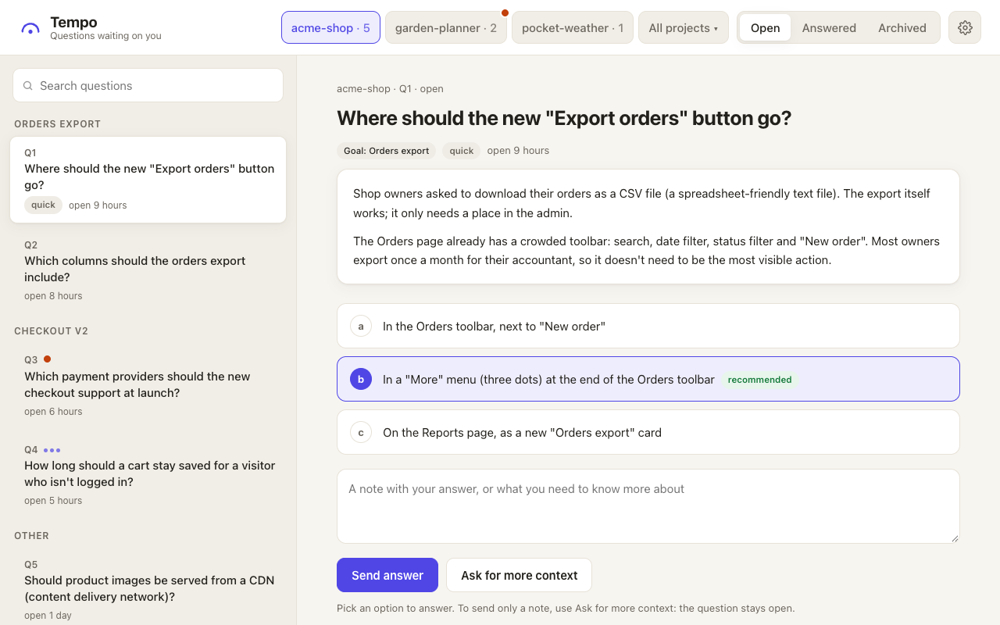
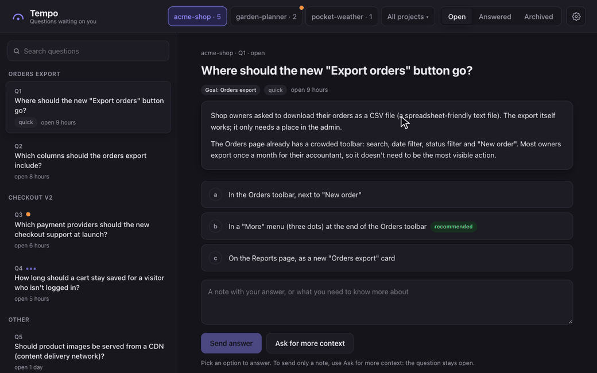

# Tempo

[](https://github.com/andrebras/tempo/actions/workflows/ci.yml)
[](LICENSE)


You set the tempo; Claude follows. Like a conductor, you decide, and Claude picks up your
decisions and keeps playing.

Tempo is a [Claude Code](https://code.claude.com) plugin. When Claude needs a decision from
you, it saves the question with all the context you need, instead of letting it scroll away
in chat. You answer on a local page whenever it suits you, and Claude picks the answer up by
itself.

<picture>
  <source media="(prefers-color-scheme: dark)" srcset="docs/screenshot-dark.png">
  <source media="(prefers-color-scheme: light)" srcset="docs/screenshot-light.png">
  
</picture>

## 🎬 See it in action



You pick an option and send it, and the page moves on to the next question. On that one, you
ask for more context; Claude rewords the question, and the thread shows what you asked and what
changed.

## 📦 Install

```bash
claude plugin marketplace add andrebras/tempo
claude plugin install tempo@tempo
```

You need Python 3.9 or newer (macOS ships with one) and Git. Tempo has no other dependencies.

To try it for one session without installing it, clone the repo and run
`claude --plugin-dir ./tempo`.

## 🎛️ Usage

There's nothing to run. When a Claude Code session starts, Tempo starts its page at
<http://127.0.0.1:2204/>. When Claude needs a decision, it adds a question and links to it in
chat. On the page you can:

- **Answer**: pick an option, add a note if you like, and send it. The page moves on to the
  next open question.
- **Ask for more context**: say what's unclear. Claude adds an explanation or rewords the
  question, and the question's thread shows what changed.
- **Reopen** an answered question to change your answer.
- **Adjust Settings** with the gear button: theme, font and text size, readable project names,
  and which repo folders share a project.

Every question has a number per project that is never reused, so answering "12b" in chat
works too.

## ⚙️ How it works

```
 Claude ──tempo add / context / reword──▶  SQLite  ◀──answer / follow-up── Page (127.0.0.1:2204)
   ▲                                          │
   └──── hook on your next message ───────────┤
   └──── tempo wait (running in background) ──┘
```

Claude writes questions with the bundled `tempo` command, following the bundled skill.
Your answers reach Claude in one of two ways: a hook adds them before Claude reads your next
message, or a `tempo wait` that Claude keeps running in the background wakes it as soon as you
answer. Each answer is delivered once, and only to sessions of its own project.

Commands, settings and environment variables are listed in [docs/reference.md](docs/reference.md).

## 🔒 Security

The page only listens on `127.0.0.1`. It refuses requests addressed to any other host name, and
only accepts answers sent as JSON from the page itself, so other websites open in your browser
can't answer for you. There is no login: anyone using your account on this machine can read
and answer your questions.

Please report security issues privately through
[GitHub security advisories](https://github.com/andrebras/tempo/security/advisories/new).

## 🤝 Contributing

Issues and pull requests are welcome. [CONTRIBUTING.md](CONTRIBUTING.md) explains how to run the
checks and the tests.

## 📄 License

[MIT](LICENSE)
